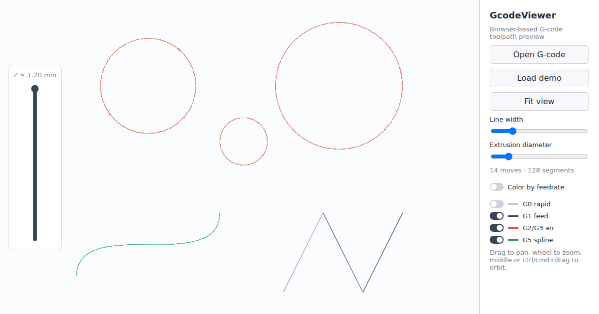

# GcodeViewer

[](https://blazewicz.github.io/GcodeVIewer/)

GcodeViewer turns a Marlin G-code file into a toolpath you can walk around. Open it
in your browser or in a small desktop window, inspect every move, arc, and Bézier
spline, and see what the printer is about to do — all on your machine.

**[Open the web viewer →](https://blazewicz.github.io/GcodeVIewer/)** — nothing to
install, and your files are never uploaded.

## Web viewer

- Drag and drop a file onto the canvas, pick one with the file dialog (`.gcode`,
  `.nc`, `.txt`), or load the bundled demo.
- Moves are color-coded by kind — `G0` rapid, `G1` feed, `G2`/`G3` arc, `G5` spline —
  and each kind can be hidden.
- Color the toolpath by feedrate to find slow details and fast travel at a glance,
  with an adjustable range that keeps outliers from flattening the scale.
- Extruding moves are drawn as round tubes whose diameter you can adjust; travel
  moves stay thin lines.
- Slide a Z cut-off through the file to look inside a print from any angle.
- See the move and segment counts of the loaded file.
- Drag to pan, scroll to zoom, middle or Ctrl/Cmd+drag to orbit, and fit the whole
  toolpath with one click.
- Files are read and parsed in chunks, so large G-code files open without freezing
  the page.

Requires a browser with WebAssembly SIMD (Chrome 91+, Firefox 89+, Safari 16.4+)
and WebGPU or WebGL 2.

## Desktop viewer

The same renderer in a native window, built from the repository:

```sh
cargo run --release -p gcode-viewer-native -- path/to/file.gcode
# or
just view path/to/file.gcode
```

The file streams in from disk in chunks, so memory stays low on large toolpaths,
and there is no interface around the image. Without a usable GPU the viewer falls
back to software rendering and says so at startup.

- **Mouse:** left-drag pans, middle-drag or Ctrl+drag orbits, and the wheel zooms
  under the cursor.
- **Keyboard:** `F` fits the toolpath, `Up`/`Down` move the Z clip (`Shift` for a
  fine step), `Z` resets it, and `Esc` quits. While clipping, the window title shows
  the cut-off height.

Use a release build for real toolpaths; debug builds parse large files far more
slowly.

## G-code support

The interpreter follows Marlin-flavored G-code:

- `G0`/`G1` linear moves, including modal moves that omit the command.
- `G2`/`G3` arcs and full circles, defined with `I`/`J` offsets or an `R` radius.
- `G5` cubic Bézier splines, linearized with Marlin's own adaptive sampling so the
  preview follows the curve as printed.
- Modal state: `G90`/`G91` positioning, `G20`/`G21` units, `G92` position offsets,
  `M82`/`M83` extrusion modes.
- `;` comments, flexible whitespace, and any case (`g1x1y2` reads the same as
  `G1 X1 Y2`).
- Common support commands (temperatures, fan control, feedrate overrides, ...) are
  recognized and skipped.

Extrusion (`E`) and feedrate (`F`) are tracked per move, which is what makes the
tube rendering and feedrate coloring accurate.

## Under the hood

A Rust G-code interpreter and a platform-neutral [wgpu](https://wgpu.rs) renderer
power both viewers, so they draw identical toolpaths. The web app compiles the
renderer to WebAssembly behind a thin binding, and its interface is TypeScript on
[Vite](https://vite.dev).

## License

GcodeViewer is source-available under the
[PolyForm Noncommercial License 1.0.0](LICENSE). Bug reports and pull requests are
welcome in the [issue tracker](https://github.com/blazewicz/GcodeVIewer/issues).
